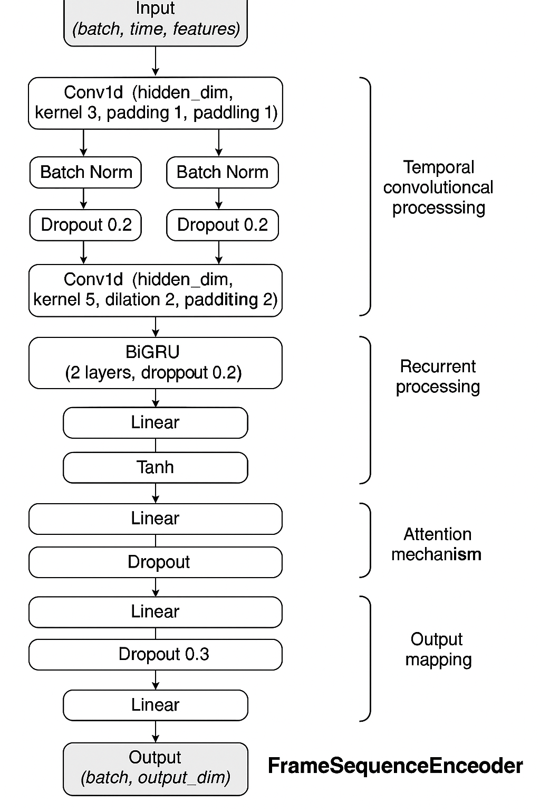

# Neural Encoding & Decoding of fMRI Responses to Narrative Speech

An end-to-end deep learning framework for **multimodal neural encoding and decoding** using fMRI data collected from 37 native Chinese speakers listening to *The Little Prince* audio narrative (dataset `ds003643`).

## Overview

This project explores how auditory and textual linguistic streams are represented in the human brain by developing two complementary deep learning pipelines:

1. **Multimodal Encoding**: Predicting whole-brain fMRI neural response patterns from continuous audio features (Mel-spectrograms, prosody) and contextual text embeddings (BERT).
2. **Neural Decoding**: Reconstructing speech audio representations and semantic features directly from high-dimensional fMRI voxel activity.



## Key Technical Components

- **Multimodal Cross-Attention Architecture** (`encoding_multimodal.py`):
  - Custom PyTorch `MultimodalEncoder` combining audio and text modalities.
  - Learnable 1D positional encodings (`LearnablePositionalEncoding`) preserving temporal narrative context.
  - Bidirectional cross-modal attention via `nn.MultiheadAttention` (Audio $\leftrightarrow$ Text).
  - 1D temporal convolution (`nn.Conv1d`) and LayerNorm layers mapping representations into a 486,180-dimensional voxel space.
- **Deep Residual Decoder** (`decoding_nn.py`):
  - `FMRIToAudioDecoder` built with residual skip connections, LeakyReLU activations, and Batch Normalization.
  - Custom differentiable Pearson Correlation loss function (`1 - mean(pearson_corr)`).
  - Optimized GPU memory footprint via dynamic caching, gradient cleanup, and batch scheduling.
- **Comparative Baseline Analysis**:
  - Regularized Ridge Regression (`ridge-regression-decoder.py`) vs. Deep Non-linear Residual Networks.
  - Validation correlation metrics evaluated across 37 subjects.
  - Adding textual embeddings to acoustic features yielded a consistent validation correlation improvement across >70% of subjects.

## Repository Structure

```
├── encoding_multimodal.py       # PyTorch Multimodal Cross-Attention Encoder
├── encoding.py                  # Single-modality encoding pipeline
├── decoding_nn.py               # Deep Residual Neural Decoder for fMRI-to-audio
├── decoding_audio.py            # Audio feature reconstruction pipeline
├── ridge-regression-decoder.py  # Regularized linear baseline decoder
├── csai-decoding.ipynb          # End-to-end decoding experiments and evaluations
├── csai-project.ipynb           # Overall project experimentation & ablation studies
├── Architecture.png             # Multimodal model architecture diagram
├── fMRI Encoding and Decoding Report.html # Interactive visual evaluation dashboard
└── Team6_Mid_Presentation.pptx  # Mid-term project defense presentation
```

## Dataset

- **OpenNeuro Dataset**: [ds003643](https://openneuro.org/datasets/ds003643) — Functional MRI narrative processing in native Chinese speakers listening to *Le Petit Prince*.
- Audio features: 1024-dimensional acoustic representations extracted from continuous speech audio using Torchaudio and OpenAI Whisper (`openai/whisper-medium`).
- Text features: Pre-trained Chinese BERT embeddings aligned with TextGrid word-level phonetic boundary annotations.
